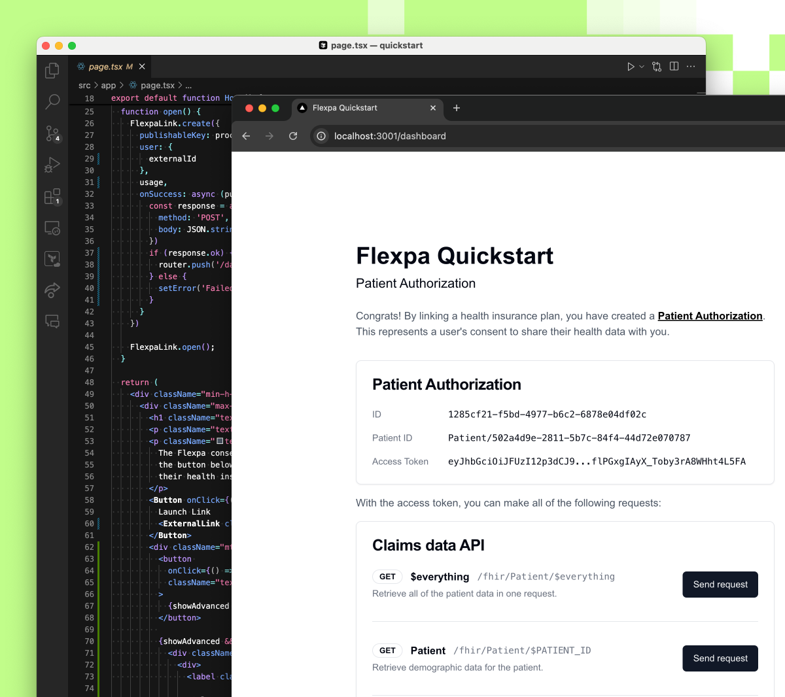

#  Flexpa Quickstart

This repository is a companion to Flexpa's [Quickstart guide](https://www.flexpa.com/docs/guides/quickstart) which provides a detailed explanation of how this code example works.

This quickstart showcases how to obtain a patient's claims history from a health plan using Flexpa's consent flow and coverage network.



## Use Flexpa with AI agents (MCP)

Flexpa runs two MCP servers.

**Connect your own records to Claude or ChatGPT.** Add `https://api.flexpa.com/mcp/consent` as a custom connector in Claude or as a custom MCP app in a supported ChatGPT account, then authorize through Flexpa Consent. Sign in to a supported health plan or patient portal, or verify your identity (IAL2) to search the national exchange (TEFCA Individual Access Services). Your assistant can then query the records from the sources you connected. Free for patients.

In Claude Code:

```bash
claude mcp add flexpa --transport http https://api.flexpa.com/mcp/consent
```

**Health tools for agents.** `https://api.flexpa.com/mcp` is a public registry agents use to discover health MCP servers and Flexpa's Endpoint Directory: search and validation of payer and provider endpoints, including plan type support and the authentication flow each one uses. Streamable HTTP, no authentication.

This quickstart's `/chat` agent uses the same Consent MCP server: it connects to `/mcp/consent` with the patient access token from Flexpa Link and gets Flexpa's patient records tools (see [Health Records Agent](#health-records-agent-optional)).

- Setup guide: [Connect your health records to Claude or ChatGPT](https://www.flexpa.com/connect-health-records-to-ai)
- Docs: [Health records for agents](https://www.flexpa.com/docs/guides/agents) and [Health tools for agents](https://www.flexpa.com/docs/guides/mcp-registry)
- Building a product: [Patient access API](https://www.flexpa.com/patient-access-api) (one FHIR R4 API for insurer, EHR and TEFCA records)

## Prerequisites

The quickstart assumes you have [Node.js and npm](https://docs.npmjs.com/downloading-and-installing-node-js-and-npm) already installed. The project is built on Next.js.

Your Flexpa API keys can be found in our [Developer Portal](https://portal.flexpa.com/). Please contact support@flexpa.com if you need keys.

## Clone

First, clone the quickstart repository.

```bash
git clone https://github.com/flexpa/quickstart.git
```

## Setup
Copy the `.env.example` file to `.env` and add your API keys.

```bash
cp .env.example .env
```

You must generate a random value for `SESSION_SECRET` in `.env`. One way is to use the following command:

```bash
openssl rand -base64 32
```

Create your API keys at [portal.flexpa.com](https://portal.flexpa.com) and copy the publishable and secret keys into `.env`. Then back in the Flexpa portal, click application settings and register `http://localhost:3000/callback` as an allowed redirect URI.

## Development

To run the project:

```bash
# Install dependencies
npm install

# Run the development server
npm run dev
```

The application will be available at [http://localhost:3000](http://localhost:3000).

## Health Records Agent (Optional)

The quickstart includes an AI-powered chat assistant at `/chat` that can answer questions about a patient's claims, demographics, and insurance coverage. It connects to the [Flexpa Consent MCP server](https://www.flexpa.com/docs/guides/agents) (`https://api.flexpa.com/mcp/consent`) with the patient access token from Flexpa Link, so the agent gets Flexpa's patient records tools alongside the local `search_records`, `search_patient` and `search_coverage` tools. If the MCP server can't be reached, the agent falls back to the local tools.

To enable it, add an API key to your `.env` file for at least one provider:

```bash
# Anthropic (default)
ANTHROPIC_API_KEY=your-key-here

# or OpenAI
OPENAI_API_KEY=your-key-here
```

The chat route at `src/app/api/chat/route.ts` uses Anthropic by default. You can swap the model by uncommenting the OpenAI import and changing the `model` parameter. The AI SDK supports [many other providers](https://sdk.vercel.ai/docs/foundations/providers-and-models) as well — including Google, Mistral, and more.

This is a minimal implementation to demonstrate the concept — in production, you would likely add more tools, refine the system prompt, implement guardrails, and tailor the agent to your specific use case.

## Health records for your own AI agent

The chat route above is one way to put claims in front of a model. Flexpa also runs a hosted MCP server, so an agent like Claude Code can query a patient's records directly after they authorize through Flexpa Consent:

```bash
claude mcp add flexpa \
  --transport http \
  https://api.flexpa.com/mcp/consent
```

Then run `/mcp` in Claude Code and complete the browser sign-in for `flexpa`.

More on building with patient records and AI:

- [Health records MCP server](https://www.flexpa.com/health-records-mcp-server): tools, resources and auth
- [Set up health records for an AI assistant](https://www.flexpa.com/docs/guides/agents) (docs)
- [Claims data and AI](https://www.flexpa.com/docs/additional-resources/claims-and-ai) (docs)
- [FHIR claims API](https://www.flexpa.com/fhir-claims-api) and [Patient Access API](https://www.flexpa.com/patient-access-api)
- [Health data API sandbox](https://www.flexpa.com/health-data-api-sandbox)

## Testing

To test the quickstart app: 

1. Open [http://localhost:3000](http://localhost:3000) in your browser
2. Click the "Connect your health plan with Flexpa Link" to open the Flexpa Link modal
3. Select any health plan payer from the list
4. When directed to the provider's site, authenticate using a [test mode login](https://www.flexpa.com/docs/getting-started/test-mode#test-mode-logins)
5. When Flexpa Link indicates success, click "Continue"

Upon successful authentication, the application will automatically exchange the public token for an access token and perform a FHIR request to demonstrate the connection.
